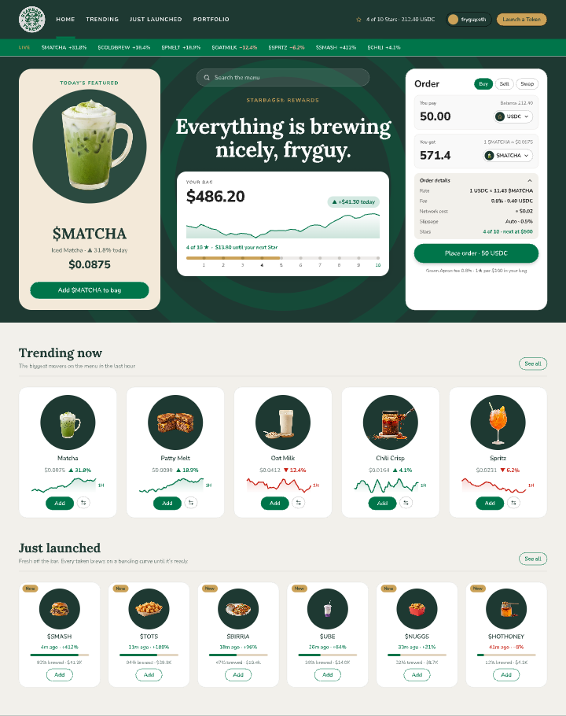
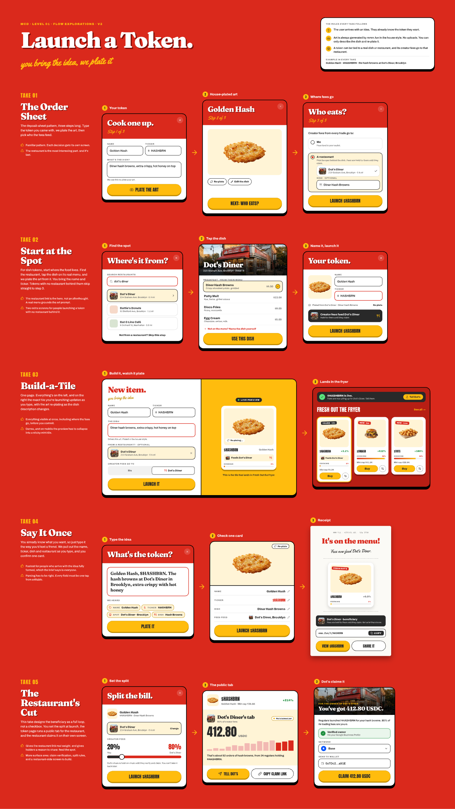

# MMM.FUN · design file + Level Up prototype

This repo holds two things:

- **The design source:** `design/mmmfun-screens.pen`, a [Pencil / pen.dev](https://pen.dev) file with every screen, level and exploration.
- **The interactive prototype:** `index.html`, one static page deployed to https://mmm-fun-prototype.vercel.app.

The design file is the source of truth. The prototype is updated by hand from it, usually by an AI agent that reads the design through Pencil's MCP server. There's no export step and no build. See [The interactive prototype](#the-interactive-prototype).



## Repo layout

| Path | What it is |
|---|---|
| `design/mmmfun-screens.pen` | The Pencil design file. Open it directly from here. |
| `design/assets/` | Images the design references, such as token cutouts, logos and merch art. |
| `design/images/` | Images generated inside Pencil, such as the NOBULL backdrop, the STARBAGS light art, and launch-flow token art. |
| `design/assets/remote/` | Local copies of images the design used to load from the web, such as Unsplash. |
| `design/fonts/` | Every font the design uses: Google Fonts and the Pangram Pangram files. See [Fonts](#fonts). |
| `design/previews/` | PNG snapshots of key screens for quick review without Pencil. |
| `scripts/sync_design.py` | Copies a Pencil working file into `design/` and makes its asset paths portable. |
| `index.html` | The prototype. A hand-maintained static page that Vercel deploys as-is. |
| `src/` | Leftovers from the first export-based version of the prototype. Not part of the workflow. |

---

## The design file

### Opening it

1. Install the Pencil desktop app and sign in to pen.dev.
2. Open `design/mmmfun-screens.pen` from your clone of this repo.

All image and font paths in the file are relative to `design/`, so it works from any clone location without extra setup.

### What's on the canvas

Every screen is a top-level frame. Names start with the step number and level.

| Group | Frames |
|---|---|
| **Level 1 · McD (McDoughnald's)** | 01 First Visit (Empty), 02 Add USDC, 03 Place First Order, 04 Order Confirmed, 05 Home (Authed · $62.47) |
| **Promotions** | 06 Level Up → STARBAGS, Level Up → SWEETGREED · $1,000, Level Up → CARBONUS · $10,000, Level Up → NOBULL · $100,000 |
| **Level homes** | 07 STARBAGS ($486.20), 08 SWEETGREED ($4,812.55), 09 CARBONUS ($38,450), 10 NOBULL ($128,940) |
| **Mobile** | A `Mobile · …` version of each screen above, at 390 wide. Mobile follows the desktop rules: crypto-only Add USDC sheet, search on every home, the same portfolio cards, and NOBULL in Direction C. |
| **mmm.supply** | The side-scrolling merch lander |
| **Boards** | `NOBULL · Layout explorations` has directions A The Statement, B Private Terminal, C The Menu and C Search “tun”. Direction C is the chosen NOBULL direction. `Level search · “tun” results` shows the search results state for McD, STARBAGS, SWEETGREED and CARBONUS. `McD · Launch a Token · v2 · 5 takes` explores the flow behind the **Launch a Token** button. No take has been picked yet. |

Previews of the main states are in `design/previews/`.



### Design system

Tokens live in the file's **variables**. Use them instead of hard-coded values when you add or change things. In Pencil, open the Variables panel. Through the MCP / `execute` API, call `GetVariables()`.

- **Level theme:** One theme axis, `level`, with values `L1` to `L5`. These map to McD, STARBAGS, SWEETGREED, CARBONUS and NOBULL. The `lvl-*` variables resolve per level:
  - **Fonts:** `lvl-font-display`, `lvl-font-body`, `lvl-font-label`
  - **Radii:** `lvl-radius-card`, `lvl-radius-pill`
  - **Surfaces:** `lvl-bg`, `lvl-surface`, `lvl-line`
  - **Text:** `lvl-ink`, `lvl-muted`
  - **Brand:** `lvl-brand`, `lvl-on-brand`, `lvl-action`, `lvl-on-action`, `lvl-highlight`
  - **Market colors:** `lvl-up`, `lvl-down`
- **Brand palettes:** `mcd-*`, `sb-*` (STARBAGS), `sg-*` (SWEETGREED), `cb-*` (CARBONUS), `nb-*` and `nobu-*` (NOBULL), `mmm-*` (mmm.supply).
- **Fonts:** `font-*` variables per brand. `font-nobu-serif` drives every serif in NOBULL Direction C, so changing that one value swaps the face.
- **Alternates:** `vault-*` and `ctr-*` are retired NOBULL explorations. Leave them alone unless you're reviving one.

### Level rules

These are product and design decisions that have already been made. Follow them so changes stay consistent.

- **Never reveal the next level** on a level's own screens. That means no brand name, logo, colors or brand-styled chips. Say "Level 3", "under wraps" or the $ threshold instead. Only the level-up promotion sheet shows the newly unlocked brand.
- **Token artwork belongs to the token, not the level.** `$MATCHA` uses the same cutout on every level. Never restyle or regenerate token images to match a theme. Generated imagery is only for backgrounds and decoration.
- **Only show token data that exists in production:** name, ticker, price, change, market cap and bonding-curve progress. Don't invent taglines, descriptions or "menu notes".
- **The portfolio card** has the value and change, a realistic chart, and the level's loyalty progress row. Nothing else: no holdings chips and no repeated stats. NOBULL has no progress row because it's the top level.
- **Loyalty progress** is based on portfolio value and uses small counts, x of 10.

  | Level | Progress |
  |---|---|
  | McD | 1 punch per $10, up to $100 |
  | STARBAGS | 1★ per $100, up to $1K |
  | SWEETGREED | 1 stamp per $1K |
  | CARBONUS | $100K private-room minimum |

  Never use per-order points.
- **Money in is crypto only.** Pick the network, then the token, then show a deposit address with QR and copy. No card or Apple Pay rails, and no summary rows that restate a control.
- **Launching a token:**
  - **The user arrives with the idea.** Don't design ideation, random rolls or concept pickers.
  - **mmm.fun generates every token's art in the house style,** the food-photo cutouts. There are no uploads. The user can only describe the dish and re-plate it.
  - **A token can be tied to a real dish or restaurant.** Its creator fees then go to that restaurant as the beneficiary.
- **Order details** start collapsed on every level except STARBAGS.
- **Search** is a "Search the menu" field centered at the top of the hero's middle column. On NOBULL Direction C it sits above the Omakase section. Results drop down under the field with the matched letters highlighted and the top match pre-selected.
- **Shared desktop grid**, used by McD through CARBONUS:
  - **Page:** 1440 wide with 48px gutters.
  - **Header:** A 36px ticker plus a 92px nav.
  - **Hero:** 360 / fill / 360 columns with a 28px gap. The hero height fits its tallest column.
  - **Sections:** 36px titles and 14px subtitles.
  - **Trending tiles:** 5 across, with 200px photo wells and 180px cutouts.
  - **Launch tiles:** 6 across, with 150px wells and 136px cutouts.

  Level personality comes from color, materials and type, not from changing the grid. NOBULL is the deliberate exception: Direction C replaces the grid with a centered menu card.
- **Level looks:**
  - **McD:** Red and yellow with stickers.
  - **STARBAGS:** A deep-green hero with cream cards, and a light #F2F0EB body.
  - **SWEETGREED:** Sage and cream.
  - **CARBONUS:** Cream menu-stock "tickets".
  - **NOBULL:** An omakase room in black lacquer and warm platinum.

  No level section should sit on plain white.

### Assets

- **Adding an image:** Put the file under `design/assets/`, or `design/images/` for generated art. Reference it relative to the `.pen` file, for example `assets/MMM-assets/generated-5.webp`. Images generated inside Pencil land in `design/images/` automatically when you work on the repo copy.
- **Token cutouts** are in `design/assets/MMM-assets/` as `generated*.webp`. Reuse them rather than adding new versions.
- **Remote images** are downloaded into `design/assets/remote/` by the sync script, so the file loads nothing from the web. The mmm.supply sky photo is from Unsplash.

### Fonts

Fonts live in `design/fonts/`.

| Folder | Fonts | In git? |
|---|---|---|
| `design/fonts/google/` | Anton, Archivo, Archivo Black, Cormorant Garamond, Fraunces, IBM Plex Mono, Instrument Sans, Inter, Libre Baskerville, Libre Caslon Text, Lora, Nunito Sans, Oswald, Silkscreen, Yellowtail | Yes. These are open-licensed TTFs from Google Fonts, one file per weight and style the design uses. Pencil loads them by name, and the prototype loads them from Google Fonts, so these files are for offline use and handoff. |
| `design/fonts/PPEditorialNew-Light.ttf` | PP Editorial New Light | Yes. It's embedded in the design file and renders the NOBULL Direction C serif (`font-nobu-serif`). |
| `design/fonts/pangram/` | Editorial New, every weight; PP Editorial Old | Yes. These are the rest of the Pangram Pangram family, for installing locally and for any `@font-face` the prototype needs. |

Two notes on licensing:

- **The Pangram Pangram fonts** are commercially licensed. The repo owner has permitted publishing them here. `sync_design.py` refreshes them from your system font folders when you sync.
- **Helvetica Neue** appears once as a system font. It's Apple's, so it isn't redistributable and isn't bundled. macOS has it built in.

**PP Editorial Old** does not render in Pencil by name, even when it's installed on your system, which is why Direction C uses Editorial New. To try Old, add an entry for `fonts/pangram/PPEditorialOld-Ultralight.otf` to the file's `fonts` list, the same way Editorial New Light is embedded. Then set `font-nobu-serif` to "PP Editorial Old".

---

## Working on the design

### Day-to-day

Work directly on the repo copy so there's one source of truth.

```bash
git pull
git checkout -b design/<short-change-name>
# open design/mmmfun-screens.pen in Pencil, make changes, save
```

Before you commit:

1. **Check the result.** Look for clipped text, collapsed layouts and contrast problems. Pencil's layout check, or `Get(screen, (n, c) => c.problems && Print(n.name, c.problems))` through the MCP, finds clipping.
2. **Refresh previews** for any screen you changed. Export at 0.5× PNG into `design/previews/` and keep the existing file names.
3. **Run `git status`.** Make sure new images and fonts are under `design/`. If you added a font family, rerun `python3 scripts/sync_design.py "design/mmmfun-screens.pen"` to bundle its files.
4. **Commit and open a PR** with a sentence on what changed and why.

```bash
git add design scripts README.md
git commit -m "Design: <what changed>"
git push -u origin design/<short-change-name>
```

### If you edited a copy outside the repo

Pencil keeps its own working copy in `~/.pencil/documents/<id>/`. That copy references images by relative paths, such as `../../../Desktop/MMM-assets/...`, that only work on the original machine. To bring it into the repo:

```bash
python3 scripts/sync_design.py                              # default working-copy path
python3 scripts/sync_design.py "/path/to/some file.pen"     # or any other .pen
```

The script does the following:
- **Images:** Copies every referenced image into `design/` and downloads remote images into `design/assets/remote/`.
- **Paths:** Rewrites every path to be relative to `design/`.
- **Token:** Strips the machine-specific `fileToken`.
- **Output:** Writes `design/mmmfun-screens.pen`.
- **Fonts:** Bundles every font family the file uses. It downloads Google Fonts TTFs and copies the licensed Pangram files from your system font folders. Edit `LOCAL_FONTS` in the script if you add another non-Google family.

It lists anything it couldn't find, and you need to fix those before committing. Add `--no-fonts` to skip the font step. Afterwards, reopen the repo copy in Pencil and spot-check a few screens.

### Working with an AI agent

Pencil runs an MCP server while the app is open, so an agent such as Claude Code can read and edit the canvas directly. Open `design/mmmfun-screens.pen` in Pencil, so the agent works on the repo copy, and include the [Level rules](#level-rules) in the brief. Most past corrections came from breaking one of them.

---

## The interactive prototype

**Live:** https://mmm-fun-prototype.vercel.app

### What's in it

- **Level 1 · McDoughnald's:** First visit, the crypto-only Add USDC sheet (tap the network or token to switch, copy the address), first order, printed receipt (three.js paper print and tear, punches stamped in), and the authed home.
- **Promotions** to STARBAGS ($100), SWEETGREED ($1K), CARBONUS ($10K) and NOBULL ($100K), each with its own home. NOBULL is Direction C, The Menu.
- **Search the menu** on every home. Type, for example "tun", to get that level's results dropdown; arrow keys move, Enter picks, Esc closes. `⌘K` or `/` focuses it.
- **Order details** start collapsed on every level except STARBAGS; tap the row to open or close them. Mobile sections with a chevron collapse too.
- **STARBAGS** hero rings ripple out from the siren.
- **mmm.supply:** The side-scrolling clothesline merch lander, driven by wheel, drag or arrow keys.
- **Desktop and mobile.** Phones get the mobile screens; anywhere else, switch with the dock button or `M`. Both walk the same steps, so switching keeps your place. Mobile sheets rise from the bottom and the tab bar sticks.
- **A demo dock** to step through levels. Use `←` and `→` to move, `H` to hide it.
- **Deep links:** `#step=6&mode=m` opens step 6 (STARBAGS) in the mobile layout. Steps count from 0.

The page loads three.js r128 and html2canvas 1.4.1 from cdnjs and Google Fonts. Everything else, including images and the PP Editorial New files for NOBULL, is inline.

### How `index.html` maps to the design

`index.html` is the whole prototype: plain HTML, CSS and one script. Its markup mirrors the design file's node tree, which is what lets an agent move changes from one to the other.

- **Screens and sheets:**
  - **Screens:** Each screen is a `<div class="screen" data-screen="p05" data-mode="d">`. Desktop screens are `p01`, `p03`, `p05`, `p07`, `p08`, `p09`, `p10` and `supply`; mobile screens are `mp01`, `mp03`, `mp05`, `mp07`, `mp08`, `mp09` and `mp10`.
  - **Sheets:** Each sheet is a `<div class="modal" data-modal="m_load">`. Desktop: `m_load`, `m_receipt`, and `m_l2` to `m_l5` for the promotions. Mobile bottom sheets use the same names with `mm_`.
- **Elements:**
  - **`data-pencil-id`:** Elements carry the ID of the design node they came from. Search `index.html` for a node ID to find its markup.
  - **`data-pencil-name`:** Elements also carry the layer name. The script finds buttons, search fields, results and collapsible headers by layer name (`Swap CTA`, `Sent CTA`, `Enter`, `Menu search`, `Search results`, `Order Summary`, `Collapse Header`, `Price Sticker`…), so renaming those layers in Pencil means updating the script too. mmm.supply still selects by node ID.
- **Images:** Images are inlined as base64 CSS variables named `--im-<file name>`; images generated in Pencil use `--im-img<file name>`. New images can also point at files under `design/`, because Vercel serves the whole repo.
- **The flow:** The `FLOW` array at the top of the script drives the demo dock, once for both layouts. Each entry has these fields:
  - `d` and `m`: the desktop and mobile screen.
  - `sheet` (optional): the sheet, without its `m_`/`mm_` prefix.
  - `lv`: the level.
  - `k` and `h`: the dock caption and hint.
  - `t`: the layer names that advance the flow when tapped, or `{d:[…], m:[…]}` when they differ.
  - `count` (optional): animates the portfolio value from, to.

  `LVSTART` maps each level to its first step.

### Updating it from the design

Treat this like any other change to the page. An agent reads the design over MCP, then edits `index.html` by hand.

1. **Open both.** Open `design/mmmfun-screens.pen` in Pencil, and start the agent in this repo with the Pencil MCP connected.
2. **Say what changed.** Name the frames, for example "05 · McD · Home: the search field and collapsed order details". Also say what the prototype should do with them.
3. **The agent reads the design.** It uses `Get(frameId, {depth: 4, resolveVariables: true})` for structure, text, sizes and resolved colors, and `GetVariables()` for tokens. It takes a `TakeScreenshot([frameId])` to see the target.
4. **The agent edits `index.html`.** It finds the markup by `data-screen` or `data-pencil-id`, and updates the HTML and CSS to match. New elements keep the node's `data-pencil-id` and `data-pencil-name`, so the next update can find them. Change the mobile screen too when the desktop one changes.
5. **New screens or sheets:**
   - **Markup:** Add a `screen` or `modal` div.
   - **Flow:** Add a `FLOW` entry whose `t` lists the tap targets, and adjust `LVSTART` if the level boundaries move.
6. **Check it in a browser.** Open `index.html` locally, step through every level in both layouts with the dock (`M` switches), and compare each changed state against the Pencil screenshot.
7. **Ship it.** Commit on a branch and open a PR. Vercel deploys from `main`.

The launch-token flow isn't in the prototype yet.

### Full rebuild from HTML exports (optional)

For a wholesale refresh, `src/build.py` regenerates the page from Pencil HTML exports and `src/shell.html`, which holds the interaction script. If you have edited `index.html` by hand since, carry those edits into `src/shell.html` first, or they will be lost.

1. **Export HTML from Pencil** (`html-css`, with layer IDs) into one folder, one file per frame:

   | File | Frame |
   |---|---|
   | `p01` `p02` `p03` `p04` `p05` `p06` | 01 to 06 McD (02 holds the Add USDC sheet, 04 the receipt, 06 the STARBAGS promotion) |
   | `p07` `p08` `p09` | 07 to 09 level homes |
   | `p07u` `p08u` `p09u` | Level Up → SWEETGREED, CARBONUS, NOBULL |
   | `p10` `p10s` | `C · NOBULL Home · The Menu` and its `Search “tun”` state |
   | `s05` `s07` `s08` `s09` | The four `Search “tun”` frames on the Level search board |
   | `supply` | mmm.supply |
   | `mp01` … `mp10`, `mp07u` `mp08u` `mp09u` | The matching `Mobile · …` frames |
   | `p01x` `p03x` `p05x` `p08x` `p09x`, `mp01x` `mp03x` `mp05x` `mp08x` `mp09x` | The same frames with their `Order Summary` rows switched on. Collapsed rows aren't exported, so export a temporary copy with them enabled, then delete the copy. |

   The build finds sheets, buttons and search results by layer name, not ID, so keep names like `Swap CTA`, `Sent CTA`, `Enter`, `Menu search`, `Search results`, `Order Summary` and `Collapse Header` when you edit.
2. **Add any new images** to `src/assets/` as compressed `.webp`. Images generated in Pencil (`design/images/…`) go in as `img-<name>.webp`, because their names clash with the token cutouts.
3. **Build.** Run `python3 src/build.py <export-folder>`, which needs `beautifulsoup4` and `lxml`. It writes `src/mmm-fun-level-up.html` and lists any image it couldn't resolve. Copy it to `index.html`.
4. **Open `index.html` locally,** step through every level in both layouts with the demo dock, then commit. Vercel deploys from `main`.
